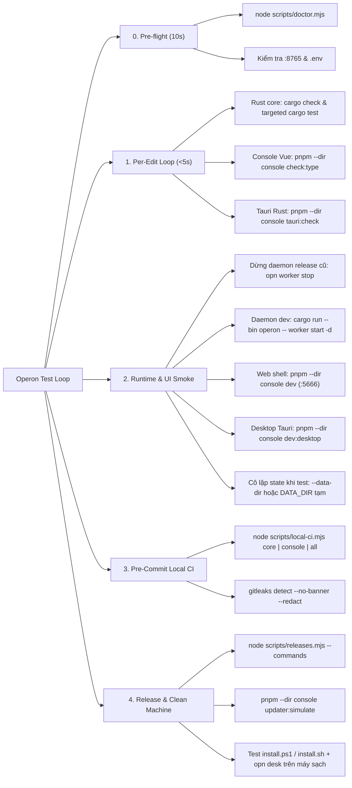

# Developer Testing Mindmap & Checklist

> Quy trình test phân tầng từ nhanh đến sâu, bám sát [`scripts/local-ci.mjs`](./scripts/local-ci.mjs), [`scripts/doctor.mjs`](./scripts/doctor.mjs) và [`console/package.json`](./console/package.json) để không tốn thời gian rebuild hoặc debug nhầm môi trường.

## 1. Mindmap Test Loop



---

## 2. Checklist thực hành khi Dev

### Bước 0 — Pre-flight (1 lần mỗi phiên làm việc)
- [ ] Chạy `node scripts/doctor.mjs` để xác nhận submodules, `rustc 1.99.1`, `clippy`, `rustfmt`, `pnpm`, `.env`, `docker` và `gh-auth` hợp lệ.
- [ ] Không chạy `cargo build --release` trực tiếp trên máy/VPS RAM thấp (3.8GB RAM / 2 Cores) — dùng profile `dev`/`test`, để GitHub Actions build release.

### Bước 1 — Vòng lặp Per-Edit (< 5s, không chạy full CI mỗi lần sửa)
- [ ] **Khi sửa Rust (`core/`):**
  ```bash
  cargo check --manifest-path core/Cargo.toml --workspace --all-targets
  cargo test --manifest-path core/Cargo.toml -p operon <ten_test_hoac_module>
  ```
- [ ] **Khi sửa CLI commands / args:**
  ```bash
  cargo test --manifest-path core/Cargo.toml -p operon test_cli_debug_assert
  cargo run --manifest-path core/Cargo.toml -p operon --bin operon -- <command> --help
  ```
- [ ] **Khi sửa Console (`console/`):**
  ```bash
  pnpm --dir console check:type
  pnpm --dir console vitest run <duong_dan_file_test>
  ```
- [ ] **Khi sửa Tauri Rust (`console/apps/workstation/src-tauri` hoặc `src-tauri`):**
  ```bash
  pnpm --dir console tauri:check
  pnpm --dir console desktop:check
  ```

### Bước 2 — Runtime & UI Smoke (`daemon` + `host shell`)
- [ ] **Tránh test nhầm binary cũ trên port `:8765`:** Nếu máy từng cài `operon`/`opn` global, dừng daemon cũ trước:
  ```bash
  opn worker stop
  ```
- [ ] **Bật `daemon` từ source đang sửa:**
  ```bash
  cargo run --manifest-path core/Cargo.toml -p operon --bin operon -- worker start -H 127.0.0.1 -p 8765
  ```
  _(Hoặc chạy VS Code task `core: daemon start` / `dev: stack`.)_
- [ ] **Mở đúng bề mặt UI cần test:**
  - Sửa UI / micro-app thông thường -> `pnpm --dir console dev` (HMR nhanh nhất tại `http://localhost:5666`).
  - Sửa Tauri IPC / native window -> `pnpm --dir console dev:desktop`.
  - Lưu ý: Không dùng `opn desk` để test code `console/` mới build nếu máy đã từng auto-install `~/.operon/apps/desk/Operon.exe` (vì `opn desk` ưu tiên chạy bản đã cài trong `~/.operon/apps/desk/`).
- [ ] **Cô lập dữ liệu khi test installer / profile / identity:** Truyền `--data-dir <thu_muc_tam>` hoặc biến môi trường `DATA_DIR` tạm để không làm bẩn `~/.operon/` thật.

### Bước 3 — Pre-Commit Gate (Mirror GitHub CI)
Nhờ cache SHA256 trong `scripts/local-ci.mjs`, chỉ phần nào thay đổi mới chạy lại:
- [ ] Sửa `core/`:
  ```bash
  node scripts/local-ci.mjs core      # cargo fmt --check, clippy -D warnings, cargo test
  ```
- [ ] Sửa `console/`:
  ```bash
  node scripts/local-ci.mjs console   # release:check, architecture, circular, type, lint, i18n, test:unit, dep
  ```
- [ ] Trước khi chốt PR / release (chạy toàn bộ):
  ```bash
  node scripts/local-ci.mjs all
  gitleaks detect --no-banner --redact
  ```
- [ ] Mẹo khi local `pnpm lint`/`vitest` pass nhưng GitHub CI đỏ: kiểm tra riêng `pnpm --dir console check:i18n`, `check:architecture`, `check:circular`, `check:dep`, `release:check` (đều đã được gom trong `node scripts/local-ci.mjs console`).

### Bước 4 — Trước khi gắn tag Release (`core-v*` / `console-v*`)
- [ ] Kiểm tra tag & version hiện tại:
  ```bash
  node scripts/releases.mjs --commands
  ```
- [ ] Nếu chạm vào logic updater của Desktop:
  ```bash
  pnpm --dir console release:check
  pnpm --dir console updater:simulate
  ```
- [ ] Luôn commit bên trong submodule (`core/` hoặc `console/`) **trước**, rồi mới commit cập nhật pointer ở repo gốc `operon`.
