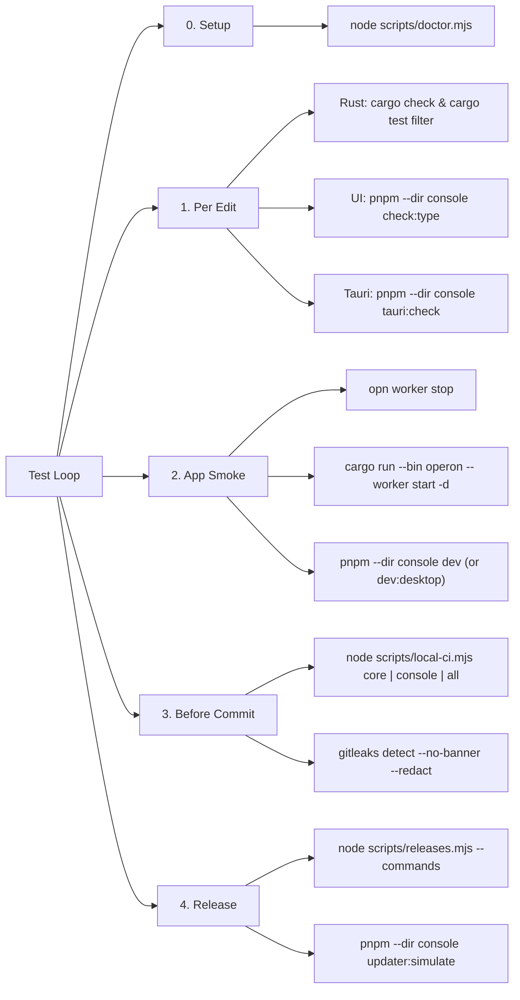

# Testing Guide

Fast test loop so you only run heavy checks when ready to commit or release.

## Mindmap



## Checklist

### 0. Setup (once per session)
- [ ] Run `node scripts/doctor.mjs`.
- [ ] Never run `cargo build --release` on low-RAM hosts.

### 1. While Coding (fast checks only)
- [ ] **Rust (`core/`):**
  ```bash
  cargo check --manifest-path core/Cargo.toml --workspace --all-targets
  cargo test --manifest-path core/Cargo.toml -p operon <test_name>
  ```
- [ ] **CLI flags/commands:**
  ```bash
  cargo test --manifest-path core/Cargo.toml -p operon test_cli_debug_assert
  cargo run --manifest-path core/Cargo.toml -p operon --bin operon -- <cmd> --help
  ```
- [ ] **Console (`console/`):**
  ```bash
  pnpm --dir console check:type
  pnpm --dir console vitest run <test_file>
  ```
- [ ] **Tauri (`console/`):**
  ```bash
  pnpm --dir console tauri:check
  ```

### 2. Local App Smoke (daemon + UI)
- [ ] Stop any old installed daemon on `:8765`: `opn worker stop`
- [ ] Start dev daemon from source:
  ```bash
  cargo run --manifest-path core/Cargo.toml -p operon --bin operon -- worker start -H 127.0.0.1 -p 8765
  ```
- [ ] Open UI: `pnpm --dir console dev` (fast Web HMR) or `pnpm --dir console dev:desktop` (Tauri).
- [ ] Skip `opn desk` for dev builds if `~/.operon/apps/desk/Operon.exe` is already installed (`opn desk` runs the installed copy first).
- [ ] Pass `--data-dir <tmp>` or temp `DATA_DIR` when testing state/profiles so you do not dirty `~/.operon/`.

### 3. Before Commit (local CI uses cache for unchanged code)
- [ ] `node scripts/local-ci.mjs core` (changed `core/` only)
- [ ] `node scripts/local-ci.mjs console` (changed `console/` only — catches `check:i18n`, `check:architecture`, `check:circular`, `check:dep`, `release:check`)
- [ ] `node scripts/local-ci.mjs all` + `gitleaks detect --no-banner --redact` (before merge/push)

### 4. Before Tagging a Release
- [ ] Run `node scripts/releases.mjs --commands`.
- [ ] If Desktop updater changed, run `pnpm --dir console release:check` and `pnpm --dir console updater:simulate`.
- [ ] Commit inside submodules (`core/`, `console/`) first, then commit the root pointer.
