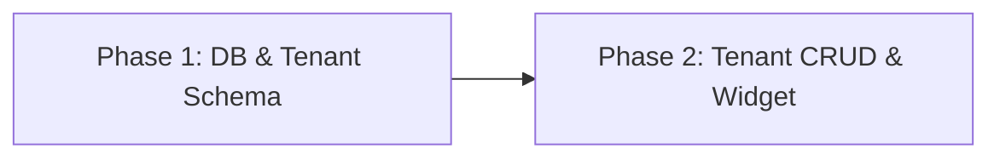

# ROADMAP-003: Tenant Management & Selector

Execution sequence for [003-tenant/001-management.md](../specs/003-tenant/001-management.md) after [001-kernel.md](./001-kernel.md) and [002-auth.md](./002-auth.md).

## Phases

1. **Phase 1 — DB & Tenant Schema:**
   - SQLite `browsers.tenant_id`, per-tenant `default_profiles`, and Drizzle `tenants` schema.
2. **Phase 2 — Tenant CRUD & Widget:**
   - `useTenantStore`, `TenantSelector`, `TenantCreateDialog`, and real `/tenants` CRUD views.
