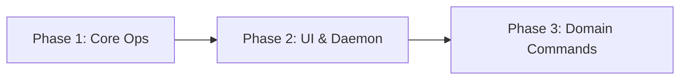

# ROADMAP-005: Operon CLI & Local Daemon

Execution sequence for [005-cli/001-overview.md](../specs/005-cli/001-overview.md) after [004-data-sync.md](./004-data-sync.md).

## Phases

1. **Phase 1 — Core Ops & Config:**
   - `auth`, `config` (`view`, `edit`), `logs` (`-f`, `errors`, `--since`), `secrets`, `update`.
2. **Phase 2 — UI Launchers & Daemon (`:8765`):**
   - `dashboard` (`--stop`, `--status`), `webapp`, `desktop`, and local HTTP/SSE/WS daemon endpoints.
3. **Phase 3 — Domain Surfaces:**
   - `browser`, `workflow` (alias `automation`), `daemon`; hidden internal `mcp`, `schema`.
