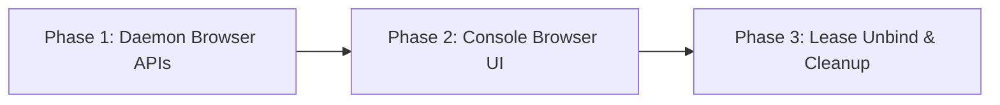

# ROADMAP-006: Browser Management

Execution sequence for [006-browsers/001-crud.md](../specs/006-browsers/001-crud.md) after [004-data-sync.md](./004-data-sync.md) and [005-cli.md](./005-cli.md) are ready.

## Phases

1. **Phase 1 — Daemon Browser CRUD & Antidetect Launch:**
   - Strict `400`/`404`/`409` guards, `PATCH`, `clone`, `move`, `proxy/probe`, `batch/delete`, `PUT /extensions`, disk cleanup, RFC-4180 CSV import, and antidetect Chromium flags.
2. **Phase 2 — Console Browser Management UI:**
   - `apps/automation/src/views/browsers.vue`, `useBrowsersStore` (SSE + workspace watcher), and Form/Detail/CSV/Delete modals.
3. **Phase 3 — Lease Unbind & Workspace Delete Guard:**
   - `POST /api/v1/browsers/{id}/unbind` and workspace delete guard/cascade cleanup in `useWorkspaceStore`.
