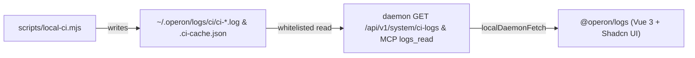

# CICD-002: Local CI Log Viewer

## 1. Goal & Scope
- **Problem:** `~/.operon/logs/ci/ci-*.log` (especially `ci-console.log` at 500+ lines across 8 steps) mixes multi-step output, Turbo replay lines, and failures in raw text, slowing down local CI diagnosis.
- **In scope:** `@operon/logs` micro-app (`console/apps/logs`) built with Vue 3 + Shadcn UI, structured CI log parser + Pinia store + Vitest unit tests, Host Shell route (`/logs`), read-only `daemon` endpoint `GET /api/v1/system/ci-logs`, and MCP `logs_read` tool (`opn mcp`).
- **Out of scope:** Cloud CI log ingestion, mutating/deleting `~/.operon/logs/` files from UI, or embedding Vite/Node `fs` into client bundles.

## 2. Flow

## 3. Data Model (`CiLogRun` / `CiStepBlock` / `CiLogLine`)

| Field | Type | Required | Default | Notes |
| --- | --- | --- | --- | --- |
| `suite` | `string` | Yes | — | `glossary` \| `core` \| `console` \| `docker` |
| `status` | `string` | Yes | `running` | `pass` \| `fail` \| `running` \| `empty` |
| `timestamp` | `string` | No | `""` | Parsed from `=== local-ci:` header |
| `gitRef` | `string` | No | `""` | Branch & short SHA from header |
| `cacheHit` | `boolean` | Yes | `false` | Derived from `.logs/.ci-cache.json` |
| `steps` | `CiStepBlock[]` | Yes | `[]` | Grouped by `> [<step>] <command>` |

## 4. Behavior & Guardrails
- **Daemon API perimeter:** `GET /api/v1/system/ci-logs` binds only on local `daemon` (`127.0.0.1:8765`), whitelists `^ci-[a-z0-9-]+\.log$` and `.ci-cache.json` inside SSOT `~/.operon/logs/ci/` (or `$DATA_DIR/logs/ci/`), and returns empty `files: []` when missing.
- **MCP parity:** `logs_read` tool in `opn mcp` shares the same SSOT `~/.operon/logs/` readers for `ci` and `daemon` logs with `suite`, `errors_only`, `search`, and `tail` filters.
- **Architecture boundaries:** `@operon/logs` consumes host state strictly via `@operon/kernel`, UI primitives from `@operon-core/shadcn-ui`, and translations via `@operon/locales` (no cross-app imports).
- **Live tail & filtering:** Supports `ci suite` selection, `ci step` accordion/filter, severity filter (`all` | `error` | `warn` | `summary`), `@operon/*` / `crates/*` scope filter, regex/text search with jump next/prev, and noise toggle (`cache hit` & Git CRLF).

## 5. Checks
- `node scripts/local-ci.mjs glossary`
- `cargo clippy --manifest-path core/Cargo.toml --workspace --all-targets -- -D warnings`
- `cargo test --manifest-path core/Cargo.toml --workspace --lib --tests`
- `node scripts/local-ci.mjs console`
