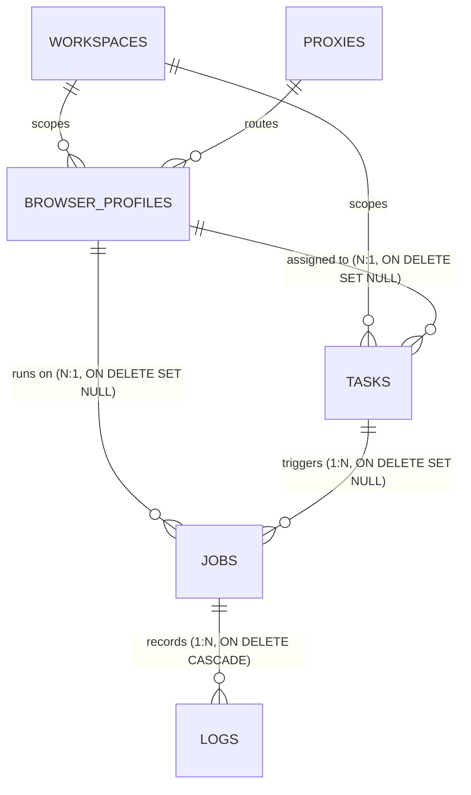

# DATA-SYNC-001: Local DB, Cloud DB ERD & Sync

## Goal
Define table ownership between `localDB` (SQLite) and `cloudDB` (Postgres), relational foreign keys across `browsers`, `tasks`, and `jobs`, shared `workspace_id` keys, and bidirectional sync rules.

## Entity Ownership & Relational Links

- **Local DB (SQLite — `~/.operon/data/operon.sqlite` & `@operon/local-db`):**
  - Core SQLite (`core/crates/cli`) owns device-local runtime tables `browsers`, `tasks` (`browser_id` FK → `browsers(id) ON DELETE SET NULL`), `jobs` (`browser_id` & `task_id` FKs), `logs` (`job_id` FK `ON DELETE CASCADE`), and `system_settings` (drops legacy `workflows`).
  - `@operon/local-db` (Drizzle) mirrors the cloud-aligned schema (`browser_profiles`, `proxies`, `workflows`, `tasks` with `profile_id` FK, `jobs`, `execution_logs`, `assets`) scoped by `workspace_id`.
  - Both enforce `PRAGMA foreign_keys = ON` with `ON DELETE SET NULL` from `tasks` and `jobs` to their parent browser/profile.
- **Cloud DB (Postgres + RLS):**
  - Owns multi-workspace control-plane state (`workspaces`, memberships, device leases, encrypted secrets) and synced definitions (`browser_profiles`, `proxies`, `workflows`, `tasks`) scoped by `workspace_id`.
  - `jobs` and `logs` execute locally per device and push only completion/audit summaries to Cloud.

## Sync (`local <-> cloud`) Rules
- Push/pull runs only with a valid session (`AUTH-001`) and active `workspace_id` (`WORKSPACE-001`).
- **Foreign-Key Pull/Push Order:** Sync executes in dependency order — `workspaces` → `proxies` → `browser_profiles` (`browsers`) → `workflows` → `tasks` — so `tasks.profile_id` (`tasks.browser_id`) and `browser_profiles.proxy_id` never violate foreign keys.
- **Conflict Resolution:** Last-Write-Wins (`updated_at`) with soft-delete tombstones (`deleted_at`); `tasks` follow the same `EntitySyncAdapter` contract as `browser_profiles` and `workflows`.
- Schema version mismatch fails fast at the boundary (no silent fallback).
- Conflict resolution and offline queue retry rules must be idempotent.
