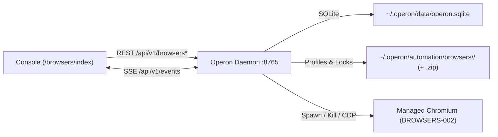
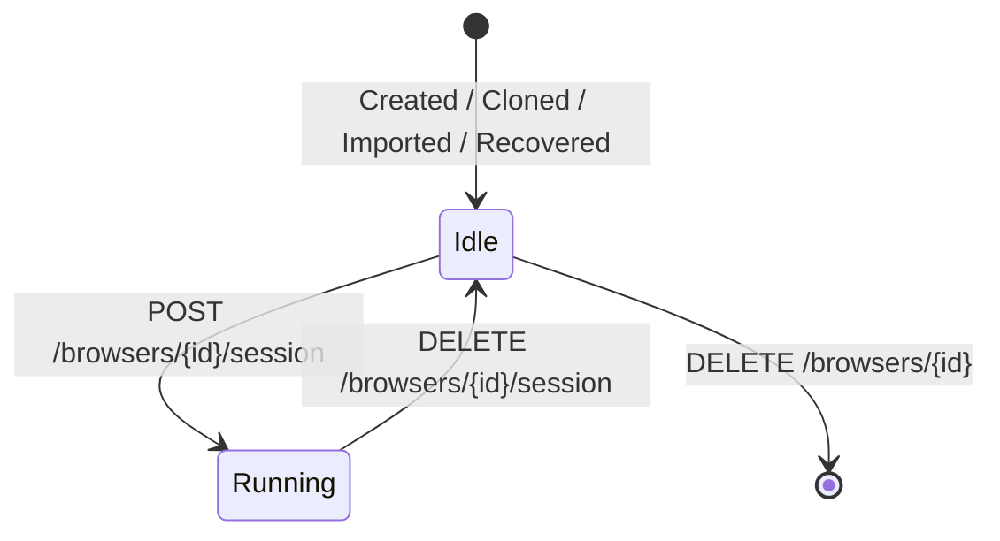

# BROWSERS-001: Browser Profile Lifecycle & Daemon API

## 1. Goal & Scope

Provide workspace-scoped `browser profile` CRUD, persistent SQLite + filesystem recovery, antidetect Chromium `browser session` launch, proxy probing, CSV import, Cloud unbind, and real-time SSE events in `operon` (`127.0.0.1:8765`).

- Console UI specifications live in [003-console-ui.md](./003-console-ui.md).
- Antidetect binary runtime installation and version resolution live in [002-antidetect-runtime.md](./002-antidetect-runtime.md).

## 2. Architecture, Persistence & Lifecycle

### Persistence & Orphan Recovery Invariants
- **Persistent SQLite (`open_persistent_db`):** Daemon and executor always open `~/.operon/data/operon.sqlite` via `resolve_db_path` (or `<data_dir>/operon.sqlite` when `DATA_DIR` / `--data-dir` overrides the default root), migrating legacy `automation/automation.sqlite` if present; never use `:memory:` for daemon state.
- **Orphan Directory Recovery (`reconcile_orphan_browser_dirs`):** On startup, daemon scans `prf_*` directories (validated by `BrowserId::is_valid()`) across `<data_dir>/browsers` and legacy `~/.operon/browser/profiles`, restoring missing rows in SQLite so upgrades (`opn update`) or restarts never drop existing profiles.
- **Disk Cleanup (`cleanup_profile_disk`):** Permanent deletion removes both `<data_dir>/<browsers_base_path>/<id>` (+ `<id>.zip`) and `~/.operon/browser/profiles/<id>` (+ `<id>.tar.zst`).

## 3. Data Model (`BrowserResponse`)

| Field | Type | Required | Default | Notes |
| --- | --- | --- | --- | --- |
| `id` | `string` | No | `prf_<12hex>` | Validated by `BrowserId::is_valid()`, immutable |
| `workspaceId` | `string` | No | `'local-default'` | Indexed in SQLite (`idx_browsers_workspace`) |
| `source` | `'local' \| 'cloud'` | Read-only | `'local'` | Derived from workspace origin (`local-*` vs Cloud) |
| `name` | `string` | Yes | — | Trimmed `1..100` chars |
| `groupName` | `string \| null` | No | `'default'` | Group label |
| `tags` | `string[]` | No | `[]` | Lowercase deduplicated, max 20 items |
| `proxy` | `string \| null` | No | `null` | `http://`, `https://`, `socks5://`, or `socks5h://` |
| `timezone` / `userAgent` | `string \| null` | No | Auto | Passed to Chromium on launch (`--timezone`, `--user-agent`) |
| `fingerprintConfig` | `FingerprintConfig` | No | PRNG seeded | `seed`, `osPlatform`, `osVersion`, `hardwareConcurrency`, `deviceMemoryGb`, `screenWidth`, `screenHeight`, `devicePixelRatio`, `webrtcMode`, `noiseLevel`, `lang`, `acceptLang` |
| `extensions` | `string[]` | No | `['automation']` | Extension IDs or unpacked paths |
| `startupFlags` | `string[]` | No | `[]` | Must start with `-`; blocks `--no-sandbox`, `--disable-web-security`, `--user-data-dir`, `--remote-debugging-port`, `--load-extension` |
| `isDefault` | `boolean` | Read-only | `false` | Per-workspace (`settings.browser.default_profiles[workspaceId]`, or `id === 'default'` fallback on `local-default`) |
| `isOnline` / `pid` / `debuggingPort` / `wsUrl` | Live | Read-only | — | Reflects active Chromium session |
| `diskSizeBytes` | `number \| null` | Read-only | `null` | Computed on `GET /api/v1/browsers/{id}` |

## 4. Daemon REST Endpoints (`/api/v1/browsers`)

- **Read:**
  - `GET /api/v1/browsers` — Supports server-side filtering (`workspaceId` or `scope=all`, `search`, `status`, `source`, `hasProxy`, `platform`, `group`, `limit`, `offset`). Console UI fetches workspace/all list and performs filtering/sorting/pagination client-side ([003-console-ui.md](./003-console-ui.md)).
  - `GET /api/v1/browsers/{id}` — Full detail + live session + `diskSizeBytes` (`404` if missing).
- **Create & Import:**
  - `POST /api/v1/browsers` — Enforces `'automation'` in `extensions`; `400` on blank name / invalid ID / invalid proxy / blocked flags; `409` on duplicate ID.
  - `POST /api/v1/browsers/{id}/clone` — Copy profile (`name`, `newId`, `targetWorkspaceId`, `preserveSeed`, `copyStorage`) with fresh PRNG seed unless `preserveSeed: true`.
  - `POST /api/v1/browsers/import-csv` — RFC-4180 CSV parser scoped to `workspaceId`, returning `{ imported, skipped, errors }`.
  - `POST /api/v1/browsers/auto-detect` — Detect host Chromium and ensure default profile exists when missing.
- **Update & Move:**
  - `PUT /api/v1/browsers/{id}` & `PATCH /api/v1/browsers/{id}` — `PATCH` updates only provided fields and clears explicit `null` fields (`404` if missing).
  - `POST /api/v1/browsers/{id}/move` — Reassign offline profile to `targetWorkspaceId` (`409` if running; clears old workspace default if pointing to this profile; unlinks any `tasks` in other workspaces by setting `browser_id = NULL` to preserve same-workspace isolation per [TASKS-001](../007-tasks/001-tasks-and-jobs.md)).
  - `POST /api/v1/browsers/{id}/set-default` — Set default profile for its `workspaceId`.
  - `PUT /api/v1/browsers/{id}/extensions` — Replace extension list while protecting `'automation'` unless `allowRemoveAutomation: true`.
  - `POST /api/v1/browsers/{id}/extensions` — Sideload unpacked extension path after validating `manifest.json`.
- **Delete:**
  - `DELETE /api/v1/browsers/{id}?force=false` — `404` if missing; `409` if running unless `force=true`. Stops session (if forced), deletes SQLite row (triggering `ON DELETE SET NULL` on linked `tasks.browser_id` and `jobs.browser_id` per [TASKS-001](../007-tasks/001-tasks-and-jobs.md)), clears workspace default if matching, and removes disk folders/archives.
  - `POST /api/v1/browsers/batch/delete` — Batch delete returning `{ deleted, skipped, errors }` (skips active sessions unless `force=true`).
- **Sessions, Proxy & Cloud Lease:**
  - `POST /api/v1/browsers/{id}/session` — Launch Chromium (`headless`, `startUrl`, `proxy` override, `args`) with deterministic `--fingerprint*`, `--lang`, `--accept-lang`, `--window-size`, `--force-device-scale-factor`, and `--disable-non-proxied-udp` when proxied and `webrtcMode !== 'default'`.
  - `DELETE /api/v1/browsers/{id}/session?force=false` — Graceful stop + sanitize + `.zip` snapshot when `force=false`, or immediate process kill when `force=true`.
  - `POST /api/v1/browsers/proxy/probe` — Pre-flight HTTP/SOCKS5 connectivity check (`alive`, `rttMs`, `egressIp`, `country`, `colo`).
  - `POST /api/v1/browsers/{id}/unbind` — Release Cloud device lease (`release_browser` RPC) when offline (`409` if running).

## 5. SSE Events (`/api/v1/events`)

Daemon broadcasts JSON frames consumed by Console clients:
- `browser_changed` (`action`: `create` | `update` | `delete` | `move` | `unbind` | `batch_create`)
- `browser_online` / `browser_offline`
- `settings_updated` (emitted on `set-default`) / `workspace_switched`

## 6. Checks

- `node scripts/local-ci.mjs core` (`cargo fmt --all -- --check`, `cargo clippy --workspace -- -D warnings`, `cargo test -p operon --lib`)
- `node scripts/local-ci.mjs console`
