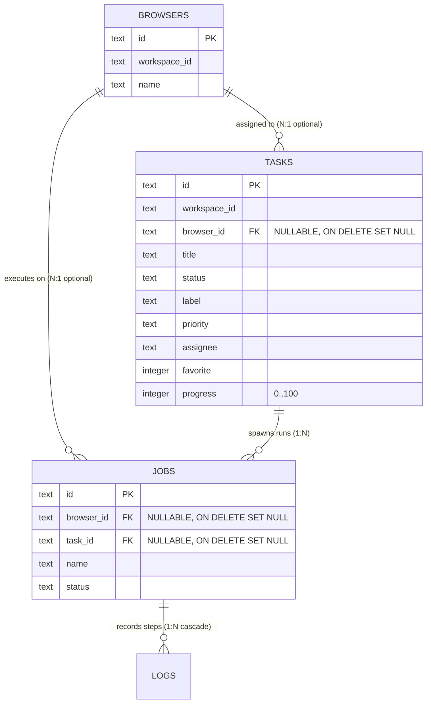

# TASKS-001: Tasks, Browser Profiles & Jobs Relational Contract

## 1. Goal & Scope

Define the canonical SQLite/Drizzle relational model, cross-entity invariants, daemon REST API (`:8765`), and Console UI (`/tasks/index`) linking **Tasks** (`tasks`), **Browser Profiles** (`browsers` / `browser_profiles`), and **Jobs** (`jobs` + `logs`).

## 2. Entity-Relationship Model

### Design Distinction: `Task` vs `Job`
- **`Task` (Durable Definition):** Long-lived executable automation unit scoped to a `workspace` and optionally assigned to one `browser profile` (`N:1`). Survives job history pruning (`cleanup_old_jobs`) and syncs across devices (`DATA-SYNC-001`).
- **`Job` (Execution Run):** Point-in-time run triggered from a `Task` (or ad-hoc workflow/CLI), carrying runtime `status`, `results`, `logs`, and lease state (`CONSTRAINTS.md` Invariant M1). Multiple `jobs` can reference the same `task_id` and `browser_id`.

## 3. Relational & Lifecycle Invariants

1. **Foreign Keys (`PRAGMA foreign_keys = ON`):**
   - `tasks.browser_id` → `browsers(id) ON DELETE SET NULL` (indexed `idx_tasks_browser`).
   - `jobs.browser_id` → `browsers(id) ON DELETE SET NULL` (indexed `idx_jobs_browser`).
   - `jobs.task_id` → `tasks(id) ON DELETE SET NULL` (indexed `idx_jobs_task`).
   - Deleting a browser profile preserves task definitions and job audit history with `browser_id = NULL`.
2. **Same-Workspace Isolation:**
   - Assigning `tasks.browser_id` on create, patch, or bulk update requires `task.workspace_id == browser.workspace_id`; cross-workspace links are rejected (`409 Conflict` / `400 Bad Request`).
   - Moving a browser profile to another workspace (`POST /api/v1/browsers/{id}/move`) automatically unlinks any tasks in other workspaces (`SET browser_id = NULL WHERE browser_id = ? AND workspace_id != ?`).
3. **Runtime Execution & Concurrency Policy:**
   - **Per-Browser Serialization:** At most one active `Job` may execute against a given `browser_id` at a time to prevent Chromium `user-data-dir` / `SingletonLock` collisions (`CONSTRAINTS.md` M2).
   - **Fail-Fast Unassigned Browser:** Triggering execution for a `Task` with `browser_id IS NULL` must fail fast with an explicit error requiring browser assignment rather than silently falling back to a default profile (`CONSTRAINTS.md` S2).
4. **Sync Ownership (`DATA-SYNC-001`):**
   - `tasks` synchronize bidirectionally (LWW via `updated_at`, scoped by `workspace_id`, soft-deleted via `deleted_at`) after `browser_profiles` (`profile_id` in `@operon/local-db` / Cloud, mapped to `browsers.id` / `browser_id` in Core SQLite).
   - `jobs` and `logs` remain device-local execution state, reporting only completion status/audit summaries to Cloud.

## 4. Daemon REST Endpoints (`/api/v1/tasks`)

- `GET /api/v1/tasks` — Query `workspaceId`, `browserId` (supports `__unassigned__`), `status`, `search`; `LEFT JOIN browsers` returns live `browserName`.
- `POST /api/v1/tasks` — Create task (`404` if `browserId` missing; `409` if `browser.workspaceId !== task.workspaceId`).
- `PATCH /api/v1/tasks/{id}` — Partial update; `browserId: null` unassigns, `browserId: "<id>"` validates existence + workspace match.
- `POST /api/v1/tasks/bulk` — Transactional bulk update across `ids` (`status`, `priority`, `label`, `assignee`, `browserId`).
- `POST /api/v1/tasks/batch/delete` & `DELETE /api/v1/tasks/{id}` — Transactional delete.
- **SSE Events (`/api/v1/events`):** Broadcasts `task_changed` (`action`: `create` | `patch` | `bulk_update` | `delete`) alongside `browser_changed`.

## 5. Checks

- `cargo test --manifest-path core/Cargo.toml --workspace --lib` (`tasks::tests`, `routes::tests::test_tasks_and_browsers_sqlite_fk_roundtrip`)
- `node scripts/local-ci.mjs console` (`@operon/local-db`, `@operon/tasks`)
