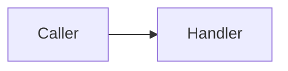

# SPEC-NNN: <Short Title>

## 1. Goal & Scope
- **Problem:** What problem are we solving?
- **In scope:** Minimal set of changes needed.
- **Out of scope:** What we explicitly skip.

## 2. Flow

## 3. Data Model

| Field | Type | Required | Default | Notes |
| --- | --- | --- | --- | --- |
| `id` | `string` | Auto | UUID | Immutable |
| `tenantId` | `string` | Yes | `local-default` | Owning tenant |

## 4. Behavior & Guardrails
- **Create / Read / Update / Delete:** Exact behavior and validation.
- **Errors (`400` / `404` / `409`):** Explicit failure rules, no silent fallbacks.

## 5. Checks
- Tests and lint/typecheck commands that must pass.
