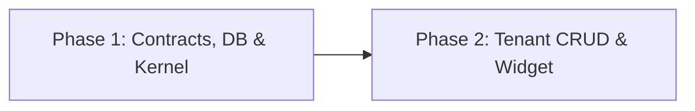

# ROADMAP-001: Foundation (Kernel Shell & Tenant)

Execution sequence for [001-tenant.md](../specs/core/001-tenant.md) across `operon` and `console`.

## Phases

1. **Phase 1 — Contracts, DB & Kernel Reactivity:**
   - SQLite `browsers.tenant_id` and per-tenant `default_profiles`.
   - Reactive `kernel.tenant` (`KernelTenantContext`) and Drizzle `tenants` schema.
2. **Phase 2 — Tenant CRUD & Widget:**
   - `useTenantStore`, `TenantSelector`, `TenantCreateDialog`, and real `/tenants` CRUD views.
