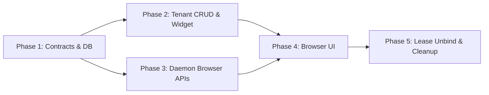

# ROADMAP-001: Tenant & Browser Management

Execution sequence for [001-tenant.md](../specs/core/001-tenant.md) and [002-browsers.md](../specs/core/002-browsers.md) across `operon` and `console`.

## Phases

1. **Phase 1 — Contracts, DB & Kernel Reactivity:**
   - SQLite `browsers.tenant_id`, `group_name`, `tags`, `fingerprint_config`, `startup_flags`, and per-tenant `default_profiles`.
   - Reactive `kernel.tenant` (`KernelTenantContext`) and Drizzle `tenants` schema.
2. **Phase 2 — Tenant CRUD & Widget:**
   - `useTenantStore`, `TenantSelector`, `TenantCreateDialog`, and real `/tenants` CRUD views.
3. **Phase 3 — Daemon Browser CRUD & Antidetect Launch:**
   - Strict `400`/`404`/`409` guards, `PATCH`, `clone`, `move`, `proxy/probe`, `batch/delete`, `PUT /extensions`, disk cleanup, RFC-4180 CSV import, and antidetect Chromium flags.
4. **Phase 4 — Console Browser Management UI:**
   - `apps/automation/src/views/browsers.vue`, `useBrowsersStore` (SSE + tenant watcher), and Form/Detail/CSV/Delete modals.
5. **Phase 5 — Lease Unbind & Tenant Delete Guard:**
   - `POST /api/v1/browsers/{id}/unbind` and tenant delete guard/cascade cleanup in `useTenantStore`.
