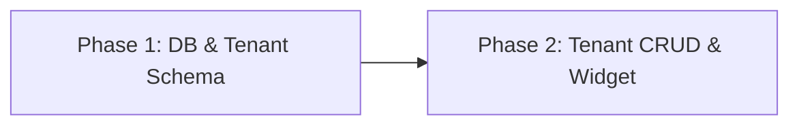

# ROADMAP-002: Tenant Management & Selector

Execution sequence for [001-tenant.md](../specs/core/001-tenant.md) across `operon` and `console` after [001-kernel.md](./001-kernel.md).

## Phases

1. **Phase 1 — DB & Tenant Schema:**
   - SQLite `browsers.tenant_id`, per-tenant `default_profiles`, and Drizzle `tenants` schema.
2. **Phase 2 — Tenant CRUD & Widget:**
   - `useTenantStore`, `TenantSelector`, `TenantCreateDialog`, and real `/tenants` CRUD views.
