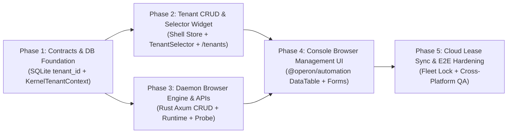

# Master Implementation Roadmap — Tenant & Browser Management

## Goal Description

Execute the specifications in [SPEC-002 Browser Management CRUD](../specs/core/SPEC-002-browser-management-crud.md) and [SPEC-001 Tenant & Selector Widget](../specs/core/SPEC-001-tenant-and-widget.md) in a strict dependency-first sequence across **`operon`** (Rust Daemon & CLI) and **`console`** (Vue 3 / Tauri UI), using **`tenant`** as the single canonical multi-tenant domain term (`CONSTRAINTS.md §S2`).

---

## User Review Required

> [!IMPORTANT]
> **Checkpoints Before Execution**
> - **Canonical Terminology:** Settled strictly on **`tenant`** (eliminating mixed `workspace` vs `tenant` domain naming in DB schemas, Kernel contracts, stores, widgets, and UI copy).
> - **Phase Gate Policy:** Each phase must pass its listed verification commands before starting the next phase.

---

## Phased Dependency Flow

---

## Phase Breakdown

### Phase 1 — Foundation Contracts, Schemas & Kernel Reactivity
**Objective:** Establish the single source of truth for `tenantId`, fingerprint config, and reactive `kernel.tenant` context so all downstream modules share identical types without shims.

- **Scope (`operon`):**
  - `crates/cli/src/infrastructure/db/schema.rs` & `browsers.rs`: Idempotent `browsers` migration adding/renaming `tenant_id` (`DEFAULT 'local-default'`), `group_name`, `tags`, `fingerprint_config`, `startup_flags`, plus `idx_browsers_tenant`.
  - `crates/cli/src/core/models/settings.rs`: Add per-tenant default profile map (`default_profiles: HashMap<String, String>`) alongside migration from legacy `default_profile_id`.
  - `crates/cli/src/api/handlers/system/tenant.rs`: Handle local tenant (`local-*`) switching cleanly when not Cloud-enrolled and broadcast `tenant_switched` SSE event.
- **Scope (`console`):**
  - `packages/kernel/src/types.ts` & `apps/shell/src/kernel/host-kernel.ts`: Back `kernel.auth.tenantId` and `kernel.tenant` (`KernelTenantContext`) with a reactive `ref` synchronized with `useTenantStore` (fixing stale `localStorage` getter).
  - `packages/local-db/src/schema/tenants.ts` & `automation.ts`: Canonical `tenants` / `tenantMembers` tables and align `browserProfiles.fingerprint` TypeScript type with `FingerprintConfig`.
- **Exit Gate:**
  - `operon`: `cargo test -p operon --lib db::` + `cargo check --workspace`
  - `console`: `pnpm -F @operon/kernel -F @operon/local-db -F @operon/shell run typecheck`

---

### Phase 2 — Tenant CRUD & Tenant Selector Widget
**Objective:** Complete real multi-tenant management across Shell header widget and `/tenants` micro-app, removing mock data (`apps/tenants/src/stores/sample.ts`).

- **Scope (`console/apps/shell`):**
  - `src/api/core/tenant.ts`: Add `updateTenant`, `deleteTenant`, `getTenantById`, `listTenantMembers`.
  - `src/store/tenant.ts`: Add `updateTenant`, `deleteTenant` (protecting `local-default` and last active tenant), sync active tenant via `POST /api/v1/system/tenants/switch`.
  - `src/components/common/tenant-create-dialog.vue`: Add `isSlugTouched`, validation, duplicate-slug handling.
  - `src/components/common/tenant-selector.vue`: Add loading skeleton, plan/source badges, responsive `minWidth` guard (preserving `X: 12..208` in desktop `header-left`), `avatar_url` fallback, and **`Manage Tenants`** link to `/tenants`.
- **Scope (`console/apps/tenants`):**
  - Replace `src/stores/sample.ts` with `src/stores/tenants.ts` backed by `useKernel().tenant`.
  - Implement real Tenant grid, Create/Rename/Archive/Delete (`AlertDialog` slug confirmation), detail cards in `views/index.vue` & `views/detail.vue`.
- **Exit Gate:**
  - `vitest run apps/shell/src/store/__tests__/tenant.test.ts apps/shell/src/components/common/__tests__/tenant-selector.test.ts`
  - `pnpm -F @operon/shell -F @operon/tenants run typecheck`
  - `pnpm run check:i18n && pnpm run check:architecture`

---

### Phase 3 — Operon Daemon Browser CRUD, Antidetect Launch & Hardening
**Objective:** Make the local daemon's `/api/v1/browsers*` API contract complete, tenant-aware, strict on errors, and leak-free on disk.

- **Scope (`operon/crates/cli` & `crates/browser`):**
  - Harden existing endpoints in `crates/cli/src/api/handlers/browsers.rs`:
    - Strict `400` on blank `name` / invalid `proxy` URI / invalid ID.
    - Strict `404` on missing IDs in `GET`, `PUT`, `PATCH`, `DELETE`, `set-default`.
    - `409 Conflict` on duplicate ID or `DELETE` while running (unless `?force=true`).
    - True disk cleanup of `~/.operon/browser/profiles/<id>/` and archives on `DELETE`.
    - Wire full antidetect fields (`fingerprint_seed`, `os_platform`, `hardware_concurrency`, `device_memory_gb`, `screen_*`, `webrtc_mode`, `lang`, `startup_flags`) into `start_browser`.
  - Add missing CRUD/helper routes in `routes.rs` & OpenAPI docs:
    - `PATCH /api/v1/browsers/{id}` (partial update preserving omitted fields)
    - `POST /api/v1/browsers/{id}/clone` (duplicate with fresh PRNG seed, optional target `tenantId`)
    - `POST /api/v1/browsers/{id}/move` (move offline profile across tenants)
    - `POST /api/v1/browsers/proxy/probe` (proxy RTT & egress IP check via `ProxyProbe`)
    - `POST /api/v1/browsers/batch/delete`
    - `PUT /api/v1/browsers/{id}/extensions`
  - Fix `core/browser/importer.rs` CSV parser (RFC-4180 quotes + `{ imported, skipped, errors }` report) & update `requests/04-browsers.rest`.
- **Exit Gate:**
  - `cargo fmt --all --check`
  - `cargo clippy --workspace --all-targets -- -D warnings`
  - `cargo test -p operon --lib`

---

### Phase 4 — Console Browser Management UI (`@operon/automation`)
**Objective:** Replace the stub `apps/automation/src/views/browsers.vue` with a complete, reactive, shadcn-vue Browser Management interface scoped by active Tenant.

- **Scope (`console/apps/automation`):**
  - `src/api/browsers.ts`: Typed wrapper over `kernel.api.localDaemonFetch` for all `/api/v1/browsers*` endpoints.
  - `src/stores/browsers.ts`: Pinia store with reactive `kernel.tenant.activeId` watcher, SSE real-time subscription (`browser_changed`, `browser_online`, `browser_offline`, `settings_updated`), per-row mutating states, and batch action handlers.
  - `src/views/browsers.vue`: `<Page :loading>` skeleton + 4 KPI cards + Search/Filter/Tenant-Scope toolbar + DataTable + floating Batch Bar (`Run`, `Stop`, `Delete`, `Unbind`).
  - `src/components/browsers/`:
    - `BrowserFormDialog.vue` (Create/Edit + Seed randomizer + OS preset + inline Test Proxy + Extensions)
    - `BrowserDetailSheet.vue` (Live PID/CDP WS inspector + Fingerprint matrix + Disk/Storage actions)
    - `BrowserImportCsvDialog.vue` (CSV preview + row error table)
    - `BrowserDeleteDialog.vue` (Single & batch confirm + force-stop running guard)
  - `src/locales/langs/{en-US,vi-VN}/automation.json`: Add missing CRUD/form keys with 100% parity.
- **Exit Gate:**
  - New `apps/automation/src/stores/__tests__/browsers.test.ts` passing
  - `pnpm -F @operon/automation -F @operon/shell run typecheck`
  - `pnpm run lint && pnpm run check:i18n && pnpm run check:architecture`

---

### Phase 5 — Cloud Fleet Sync, Cross-Tenant Cleanup & Full Verification
**Objective:** Connect multi-device Cloud lease locking (`acquire` / `release` / `unbind`), tenant delete cascades, and verify end-to-end across Web, PWA, and Tauri Desktop.

- **Scope (`operon` + `console`):**
  - Wire Cloud lease endpoints (`POST /api/v1/browsers/{id}/unbind`, `acquire`, `release`) and `.tar.zst` storage snapshot sync.
  - Hook tenant deletion in `useTenantStore` to clean up or migrate local browsers belonging to the deleted tenant.
  - Run full quality verification across both repos (`pnpm check`, `pnpm lint`, `pnpm test:unit`, `cargo check --workspace --all-targets`).
- **Exit Gate:**
  - Full automated suites green on both `operon` and `console`.
  - Manual E2E walkthrough covering Tenant Switch ↔ Browser CRUD ↔ Launch/Stop Chromium ↔ Force Delete ↔ CSV Import ↔ Cloud Unbind.
