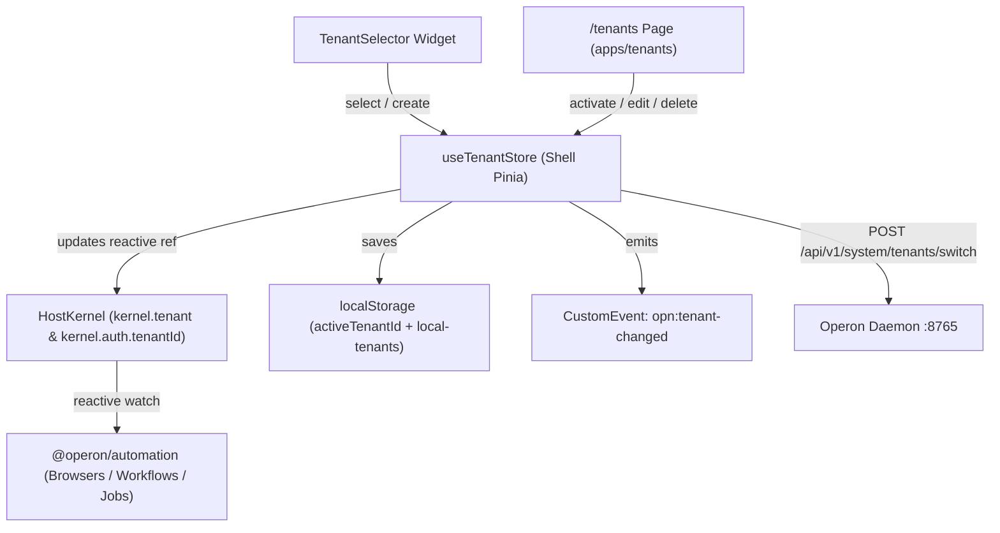

# SPEC-003: Tenant Management & Selector Widget

## 1. Goal & Scope

Unify multi-tenant state across `console` (`@operon/kernel`, `apps/shell`, `apps/tenants`, `packages/local-db`) and `operon` (`crates/cli`) using `tenant` ([ADR-0001](../../adr/0001-tenant-term.md)).

- **In scope:** Reactive `kernel.tenant` context, Shell tenant store (Local + Cloud CRUD), `TenantSelector` header widget, `/tenants` micro-app, and daemon `local-*` tenant switching.
- **Out of scope:** Cloud billing/member invite UI changes.

## 2. Reactive Flow

## 3. Data Model (`KernelTenantRecord`)

| Field | Type | Required | Notes |
| --- | --- | --- | --- |
| `id` | `string` | Auto | Cloud UUID, `'local-default'`, or `'local-<8hex>'` |
| `name` | `string` | Yes | `2..60` chars trimmed |
| `slug` | `string` | Yes | Lowercase `[a-z0-9-]{2,48}`, unique |
| `plan` | `string` | No | `'local' \| 'free' \| 'pro' \| 'enterprise'` |
| `status` | `string` | Auto | `'active' \| 'archived' \| 'suspended'` |
| `avatarUrl` | `string \| null` | No | Falls back to first-letter badge |

## 4. CRUD & Guardrails

- **Create:** Auto-generates `slug` from `name` until user edits `slug` manually (`isSlugTouched`). Rejects duplicate slugs.
- **Read / Switch:** Loads Cloud tenants when signed in, or `local-tenants` when offline. Blocks switching to `archived` or `suspended` tenants.
- **Update:** Edits `name`, `slug`, `plan`, or `status` in Cloud (`PATCH /rest/v1/tenants`) or `localStorage`.
- **Delete:**
  - Blocks deleting `local-default` or the last remaining tenant.
  - Blocks deleting if daemon reports running browser sessions in that tenant.
  - Requires typing the exact `slug` in confirmation dialog.
  - Cleans up owned offline browser profiles via `POST /api/v1/browsers/batch/delete`.
  - If the deleted tenant was active, switches to the next active tenant.

## 5. Widget (`tenant-selector.vue`)

- **Expanded (`!collapsed`):** `h-9` button; uses `minWidth = sidebar.width - 24` when placed in desktop `header-left`. Shows avatar/initial, `name`, and `slug`.
- **Collapsed (`collapsed === true`):** `size-9` icon button.
- **Popover:** Searchable `Command` list with plan badges, loading skeleton, **`Create New Tenant`** (`TenantCreateDialog`), and **`Manage Tenants`** link to `/tenants`.

## 6. Checks

- `vitest run apps/shell/src/store/__tests__/tenant.test.ts apps/shell/src/components/common/__tests__/tenant-selector.test.ts`
- `pnpm check:type`, `pnpm run check:i18n`, `pnpm run check:architecture`, `pnpm lint`
