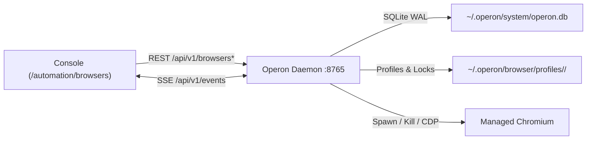
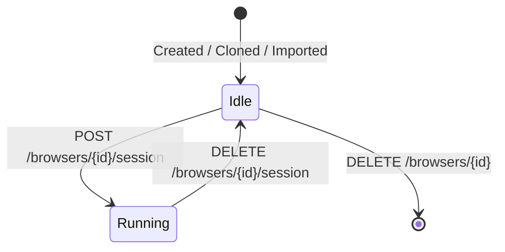

# SPEC-002: Browser Management CRUD & Lifecycle

## 1. Goal & Scope

Provide full tenant-scoped Browser Profile CRUD, antidetect Chromium launch, proxy testing, CSV import, and real-time UI sync across `operon` (`127.0.0.1:8765`) and `console` (`apps/automation/src/views/browsers.vue`).

## 2. Architecture & Lifecycle

## 3. Data Model (`BrowserResponse`)

| Field                                          | Type                | Required  | Default           | Notes                                                                                                              |
| ---------------------------------------------- | ------------------- | --------- | ----------------- | ------------------------------------------------------------------------------------------------------------------ |
| `id`                                           | `string`            | No        | `prf_<12hex>`     | Validated by `BrowserId::is_valid()`, immutable                                                                    |
| `tenantId`                                     | `string`            | No        | `'local-default'` | Indexed in SQLite (`idx_browsers_tenant`)                                                                          |
| `name`                                         | `string`            | Yes       | —                 | Trimmed `1..100` chars                                                                                             |
| `groupName`                                    | `string \| null`    | No        | `'default'`       | Group label                                                                                                        |
| `tags`                                         | `string[]`          | No        | `[]`              | Max 20 lowercase tags                                                                                              |
| `proxy`                                        | `string \| null`    | No        | `null`            | `http://`, `https://`, `socks5://`, `socks5h://`                                                                   |
| `timezone` / `userAgent`                       | `string \| null`    | No        | Auto              | Passed to Chromium on launch                                                                                       |
| `fingerprintConfig`                            | `FingerprintConfig` | No        | PRNG seeded       | `seed`, `osPlatform`, `hardwareConcurrency`, `deviceMemoryGb`, `screenWidth`, `screenHeight`, `webrtcMode`, `lang` |
| `extensions`                                   | `string[]`          | No        | `['automation']`  | Extension IDs or unpacked paths                                                                                    |
| `startupFlags`                                 | `string[]`          | No        | `[]`              | Dangerous flags blocked                                                                                            |
| `isDefault`                                    | `boolean`           | Read-only | `false`           | Per-tenant (`settings.browser.default_profiles[tenantId]`)                                                         |
| `isOnline` / `pid` / `debuggingPort` / `wsUrl` | Live                | Read-only | —                 | From active Chromium session                                                                                       |

## 4. Daemon REST Endpoints (`/api/v1/browsers`)

- **Read:**
  - `GET /api/v1/browsers` — Filter by `tenantId` (or `scope=all`), `search`, `status`, `hasProxy`, `platform`, `group`, `limit`, `offset`.
  - `GET /api/v1/browsers/{id}` — Full detail + live session + `diskSizeBytes`. Returns `404` if missing.
- **Create & Import:**
  - `POST /api/v1/browsers` — `400` on blank name / invalid ID / invalid proxy / blocked flags; `409` on duplicate ID.
  - `POST /api/v1/browsers/{id}/clone` — Copy profile with fresh PRNG seed (unless `preserveSeed: true`) into target tenant.
  - `POST /api/v1/browsers/import-csv` — RFC-4180 CSV parser returning `{ imported, skipped, errors }`.
  - `POST /api/v1/browsers/auto-detect` — Ensure default Chromium profile exists.
- **Update & Move:**
  - `PUT /api/v1/browsers/{id}` & `PATCH /api/v1/browsers/{id}` — `PATCH` updates only provided fields and clears explicit `null` fields. Returns `404` if missing.
  - `POST /api/v1/browsers/{id}/move` — Move offline profile to `targetTenantId` (`409` if running).
  - `POST /api/v1/browsers/{id}/set-default` — Set default profile for its `tenantId`.
  - `PUT /api/v1/browsers/{id}/extensions` & `POST /api/v1/browsers/{id}/extensions` — Configure or sideload extensions.
- **Delete:**
  - `DELETE /api/v1/browsers/{id}?force=false` — `404` if missing; `409` if running unless `force=true`. Deletes SQLite row, clears tenant default if needed, and removes disk folders/archives.
  - `POST /api/v1/browsers/batch/delete` — Batch delete returning `{ deleted, skipped, errors }`.
- **Sessions, Proxy & Cloud Lease:**
  - `POST /api/v1/browsers/{id}/session` — Launch Chromium with full antidetect args (`--fingerprint*`, `--lang`, `--window-size`, `--disable-non-proxied-udp`).
  - `DELETE /api/v1/browsers/{id}/session?force=false` — Graceful stop (preserves cookies) or force kill.
  - `POST /api/v1/browsers/proxy/probe` — Test proxy connectivity (`alive`, `rttMs`, `egressIp`, `country`).
  - `POST /api/v1/browsers/{id}/unbind` — Release Cloud device lease (`release_browser` RPC) when offline.

## 5. Console UI (`apps/automation`)

- Store: `useBrowsersStore` watches `kernel.tenant.activeId`, clears selection on switch, and subscribes to daemon SSE.
- Page: `views/browsers.vue` with heartbeat skeleton, offline gate, 4 KPI cards, filter toolbar, Table, batch bar, and 4 dialogs (`BrowserFormDialog`, `BrowserDetailSheet`, `BrowserImportCsvDialog`, `BrowserDeleteDialog`).

## 6. Checks

- `operon`: `cargo fmt --all -- --check`, `cargo test -p operon --lib`, `cargo clippy --workspace -- -D warnings`
- `console`: `vitest run apps/automation/src/stores/__tests__/browsers.test.ts`, `pnpm check:type`, `pnpm lint`, `pnpm run check:i18n`, `pnpm run check:architecture`
