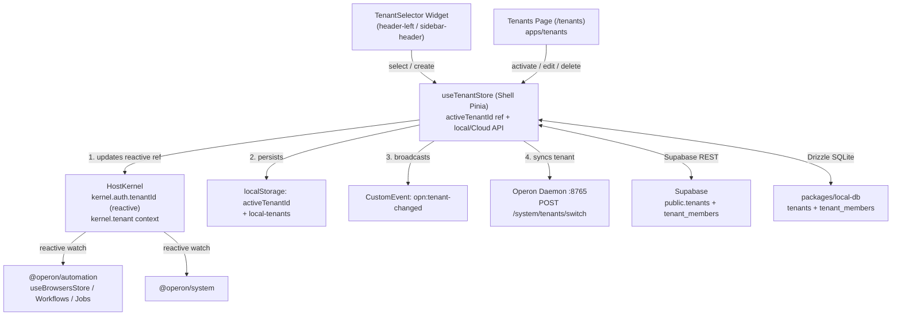

# Tenant Management & Tenant Widget — Full Specification

## Goal Description

Design and specify the complete **Tenant (Multi-Tenant)** lifecycle and the **Tenant Selector Widget** across `console` (`@operon/kernel`, `apps/shell`, `apps/tenants`, `packages/local-db`) and `operon` daemon (`crates/cli`), standardized strictly on the **`tenant`** domain term (`CONSTRAINTS.md §S2`).

---

## Architecture & Reactive Propagation



### Layout Placement & Zone Rules

```mermaid
flowchart LR
    PREF["preferences.widget.tenantSelectorButtonPosition"]
    PREF -->|header-left (default)| HL["Header Left<br/>minWidth = sidebar.width - 24 (196px)<br/>X: 12..208 aligned with sidebar"]
    PREF -->|header-right| HR["Header Right<br/>compact auto width (max-w-[220px])"]
    PREF -->|sidebar-header| SH["Sidebar Header<br/>expanded: w-full | collapsed: size-9 icon"]
    PREF -->|none| HIDDEN["Hidden (switchable via /tenants or Cmd+K)"]
```

---

## Canonical Data Model (`KernelTenantRecord` & `TenantMemberDTO`)

| Field | Type | Mode | Description & Validation |
| --- | --- | --- | --- |
| `id` | `string` | Read-only | UUID (Cloud) or `'local-default'` / `'local-<8hex>'` (Local). |
| `name` | `string` | **Required** | `2..60` chars trimmed. Display label across widget & cards. |
| `slug` | `string` | **Required** | URL-safe lowercase `[a-z0-9-]{2,48}`, unique within Cloud org / local list. Auto-generated from `name` on create (`isSlugTouched` guarded). |
| `plan` (`tier`) | `'local' \| 'free' \| 'pro' \| 'enterprise'` | Optional | Service tier stored in `metadata.plan` (Cloud) / `tier` (local-db). |
| `status` | `'active' \| 'archived' \| 'suspended'` | Managed | From `TENANT_STATUS`. Archived/suspended tenants are read-only and cannot be activated for new jobs. |
| `source` | `'cloud' \| 'local'` | Derived | Derived from `id.startsWith('local-')` / `created_by === 'local'`. |
| `role` | `'owner' \| 'admin' \| 'member' \| 'viewer'` | Cloud only | Caller's membership role. Local tenants default to `'owner'`. |
| `avatarUrl` | `string \| null` | Optional | Optional tenant icon URL; falls back to uppercase initial avatar. |
| `createdAt` / `updatedAt` | `string (ISO 8601)` | Read-only | Timestamps. |

---

## Part 1: Tenant CRUD Specification (`apps/shell` + `apps/tenants` + `local-db`)

### 1.1 CREATE Tenant
- **Entry Points:**
  1. Quick trigger inside `TenantSelector` popover → **`Create New Tenant`** (`TenantCreateDialog`).
  2. Primary button **`+ Create`** on `/tenants` page (`apps/tenants/src/views/index.vue`).
- **Validation Rules:**
  - `name`: required, `2..60` chars, trimmed.
  - `slug`: lowercase `[a-z0-9-]+`, `2..48` chars; auto-slugified from `name` until user edits `slug` manually (`isSlugTouched`).
  - Conflict check: reject duplicate `slug` locally or handle Postgres `23505` unique violation with inline error.
  - `plan`: defaults to `'local'` (unauthenticated local mode) or `'pro'` / `'free'` (Cloud mode).
- **Execution Flow:**
  - **Local Mode:** Create `local-<uuid8>` entry, save to `localStorage` (`operon:local-tenants`), auto-activate, emit `opn:tenant-changed`.
  - **Cloud Mode:** `POST /rest/v1/tenants`, prepend to store, auto-activate, sync daemon tenant (`POST /api/v1/system/tenants/switch`).

### 1.2 READ / List / Switch Tenants
- **List Tenants:**
  - `useTenantStore.fetchTenants()` loads Cloud tenants (when authenticated) or local tenants (when local).
  - **Tenants Hub (`/tenants`):** Active tenant summary card, Search + Plan/Status filters + Cards view.
  - **Tenant Detail (`/tenants/:id`):** Tenant metadata, Tenant ID copy, CLI switch command, Edit & Delete actions.
- **Switch Active Tenant (`setTenant(id)`):**
  - Guard: block activating `'archived'` or `'suspended'` tenants.
  - Update reactive `activeTenantId`, persist to `STORAGE_KEYS.ACTIVE_TENANT_ID`, update reactive `HostKernel` (`kernel.auth.tenantId` & `kernel.tenant`), update Bugsink tag (`tenant_id`), fire `opn:tenant-changed`, and call `POST /api/v1/system/tenants/switch`.

### 1.3 UPDATE Tenant (`PATCH /rest/v1/tenants?id=eq.<id>` / Local Store)
- **Editable Fields:** `name`, `slug`, `plan`, `status` (`active` | `archived` | `suspended`).
- **Local Mode:** Updates `localStorage` + reactive `tenants`; header `TenantSelector` updates instantaneously.

### 1.4 DELETE Tenant
- **Guards:**
  1. **`local-default` Protection:** Default tenant (`local-default`) cannot be deleted.
  2. **Last Tenant Protection:** At least one tenant must remain.
  3. **Confirmation Modal (`AlertDialog`):** Requires typing the tenant `slug` to confirm permanent deletion.
- **Cleanup Sequence:**
  1. Delete in backend (`DELETE /rest/v1/tenants?id=eq.<id>` or local store remove).
  2. If deleted tenant was **active**, automatically switch to fallback active tenant and trigger `opn:tenant-changed`.

---

## Part 2: Tenant Selector Widget Specification (`tenant-selector.vue`)

- **Trigger Button — Expanded (`!collapsed`):** `h-9`, `minWidth = preferences.sidebar.width - 24` when positioned in desktop `header-left`, `avatar_url` fallback badge, two-line name/slug stack.
- **Trigger Button — Collapsed (`collapsed === true`):** Square icon button `size-9`.
- **Popover Content:** `Command` searchable list grouped by Cloud vs Local Tenants, plan badges, check indicator, plus footer **`Create New Tenant`** (`TenantCreateDialog`) & **`Manage Tenants`** (`/tenants`).

---

## Proposed Changes

### Component 1: `@operon/kernel` & `apps/shell/src/kernel/host-kernel.ts`

#### [MODIFY] `packages/kernel/src/types.ts` & `packages/kernel/src/mock.ts`
- Exposed `KernelTenantContext` (`kernel.tenant`) alongside reactive `kernel.auth.tenantId` backed by Vue reactivity.

#### [MODIFY] [host-kernel.ts](file:///c:/Users/ndtu6/Repository/console/apps/shell/src/kernel/host-kernel.ts)
- Backed `auth.tenantId` and `kernel.tenant` with reactive bindings to `useTenantStore()`.

---

### Component 2: `apps/shell` (Tenant Store, API & Widget)

#### [MODIFY] [tenant.ts](file:///c:/Users/ndtu6/Repository/console/apps/shell/src/api/core/tenant.ts)
- Added `updateTenant(id, patch)` (`PATCH /rest/v1/tenants?id=eq.<id>`) and `deleteTenant(id)` (`DELETE /rest/v1/tenants?id=eq.<id>`), plus `listTenantMembers(tenantId)` / `getTenantById(id)`.

#### [MODIFY] [tenant.ts](file:///c:/Users/ndtu6/Repository/console/apps/shell/src/store/tenant.ts)
- Added `updateTenant(id, patch)` and `deleteTenant(id)` actions (supporting both local storage & Cloud REST, enforcing `local-default` protection, syncing daemon tenant via `/api/v1/system/tenants/switch`).

#### [MODIFY] [tenant-selector.vue](file:///c:/Users/ndtu6/Repository/console/apps/shell/src/components/common/tenant-selector.vue)
- Added responsive `minWidth` guard, skeleton loading states, plan badges, `avatar_url` fallback, and **`Manage Tenants`** action navigating to `/tenants`.

#### [MODIFY] [tenant-create-dialog.vue](file:///c:/Users/ndtu6/Repository/console/apps/shell/src/components/common/tenant-create-dialog.vue)
- Added `isSlugTouched`, validation errors, duplicate-slug error display, and clean reset on open.

---

### Component 3: `apps/tenants` (Unified Real Tenant CRUD Views)

#### [DELETE] `sample.ts` (Replaced by [tenants.ts](file:///c:/Users/ndtu6/Repository/console/apps/tenants/src/stores/tenants.ts))
- Removed hardcoded mock state ([CONSTRAINTS.md §S2](file:///c:/Users/ndtu6/Repository/operon/CONSTRAINTS.md#L36-L40)).

#### [MODIFY] [index.vue](file:///c:/Users/ndtu6/Repository/console/apps/tenants/src/views/index.vue) & [detail.vue](file:///c:/Users/ndtu6/Repository/console/apps/tenants/src/views/detail.vue)
- Connected to live tenants via `useKernel().tenant` with real Create / Activate / Edit / Delete (`AlertDialog` slug confirmation).

---

### Component 4: `operon/crates/cli` (Daemon Tenant Context Alignment)

#### [MODIFY] [tenant.rs](file:///c:/Users/ndtu6/Repository/operon/crates/cli/src/api/handlers/system/tenant.rs)
- Supported switching/reporting local tenant (`local-*`) context cleanly and broadcasting `tenant_switched` SSE events.

---

## Verification Plan

### Automated Tests
1. **Console Unit Tests (`vitest run`):**
   - `apps/shell/src/store/__tests__/tenant.test.ts`
   - `apps/shell/src/components/common/__tests__/tenant-selector.test.ts`
2. **Type, Lint & Boundary Gates:**
   - `pnpm check:type`, `pnpm test:unit`, `pnpm run check:i18n`, `pnpm run check:architecture`, `pnpm lint`.
