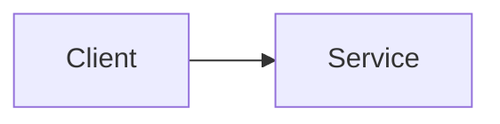

# SPEC-NNN: <Title>

## 1. Mục tiêu & Phạm vi (Goal & Scope)
- **Bài toán:** ...
- **Trong phạm vi (In-Scope):** ...
- **Ngoài phạm vi (Out-of-Scope):** ...

## 2. Kiến trúc & Luồng dữ liệu (Architecture & Flow)

## 3. Data Model & Contracts

| Field | Type | Required | Default | Validation / Notes |
| --- | --- | --- | --- | --- |
| `id` | `string` | Auto | UUID | ... |
| `tenantId` | `string` | Yes | `local-default` | ... |

## 4. API / UI / CLI Behavior
- **Create:** ...
- **Read / Filter:** ...
- **Update:** ...
- **Delete & Guardrails:** ...
- **Error Handling (`400` / `404` / `409`):** ...

## 5. Kế hoạch kiểm thử (Verification Plan)
- Unit tests: ...
- Integration / E2E tests: ...
